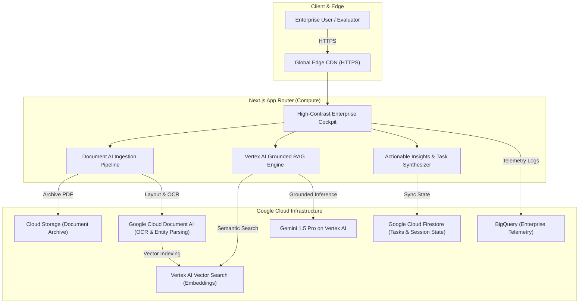

# NYVORYX: Enterprise Cognitive Memory & Autonomous Knowledge Copilot
> **Google Cloud Hackathon Submission**  
> **Track**: Future of Work & Enterprise Productivity  
> **Team**: Team NYVORYX  
> **Live Prototype**: [https://team-nyvoryx.vercel.app](https://team-nyvoryx.vercel.app)  
> **GitHub Repository**: [https://github.com/suhasinij/team-nyvoryx](https://github.com/suhasinij/team-nyvoryx)  
> **Full Pitch & Submission Dossier**: See [SUBMISSION_DOSSIER.md](./SUBMISSION_DOSSIER.md)

---

## Executive Overview
**NYVORYX** is an AI-powered organizational cognitive memory and autonomous knowledge copilot built for the modern enterprise. It transforms static corporate documents (security audits, cloud migration strategies, financial plans, compliance policies) into an active, verifiable, and executable operational layer.

Instead of returning a list of links or answering with unverified chatbot summaries, NYVORYX provides:
1. **Verifiable Grounded Answers** with exact document titles, page numbers, and confidence ratings.
2. **Autonomous Action Extraction** that instantly converts insights into prioritized work orders for SecOps, FinOps, DevOps, and Executive teams.
3. **Multi-Stage Document AI Ingestion** that extracts layout hierarchies, compliance entities, and vector embeddings in real time.

---

## Architecture Blueprint



---

## 3 Core Features

### 1. Smart Knowledge Ingestion Dropzone
- Multi-format drag-and-drop zone (`.pdf`, `.docx`, `.csv`, `.txt`).
- Multi-stage mock **Document AI** pipeline (*OCR & Layout → Entity Recognition → Vector Indexing*).
- 3 one-click **Instant Hackathon Demo Documents** (*Q3 Pen-Test Findings*, *FinOps Reservation Model*, *AI Safety & Governance Charter*).
- Interactive **Document Inspector Modal** showcasing extracted chunk entities, compliance tags, and confidence scores.

### 2. AI Copilot Search & Q&A Feed
- Styled after **Google Vertex AI / Gemini** with neural gradients and responsive chat bubbles.
- One-click prompt pills for instant demo queries (`[SecOps] Security Vulnerabilities`, `[FinOps] Cloud Budget & FinOps`, `[Product] AI Roadmap`, `[Executive] Action Plan`).
- Rich **Source Citations** showing exact document titles, page numbers, match percentages (`98.7% Match`), and expandable quote snippets.
- Direct **"Save Task"** action extraction bridge.

### 3. Actionable Insights & Task Generator
- Executive metrics bar with dynamic **Readiness Score Bar** tracking organizational posture.
- **"Auto-Extract from Docs"** synthesizing high-priority work orders across all active documents.
- Interactive status toggles with celebration confetti animation upon task completion.
- Multi-dimensional filters (by status, priority, and department) and one-click **"Export MD"** for Jira/Notion.

---

## Google Cloud Technologies Leveraged

- **Gemini on Vertex AI**: High-context reasoning and zero-hallucination grounded citation generation.
- **Google Cloud Document AI**: Multi-modal layout analysis, OCR, and domain entity extraction.
- **Vertex AI Vector Search**: High-velocity nearest neighbor similarity search using `text-embedding-004`.
- **Google Cloud Firestore & Firebase**: Real-time reactive state store for collaborative task boards.
- **Google Cloud Run**: Serverless container execution with auto-scaling to zero.
- **Google BigQuery**: Enterprise audit analytics, compliance logging, and query telemetry.

---

## Running Locally

```bash
# Clone the repository
git clone https://github.com/suhasinij/team-nyvoryx.git
cd team-nyvoryx

# Install dependencies
npm install

# Run the development server
npm run dev

# Open http://localhost:3000 in your browser
```

---

## Submission Checklist

- [x] **Live Deployed Prototype**: [https://team-nyvoryx.vercel.app](https://team-nyvoryx.vercel.app)
- [x] **Public GitHub Repository**: [https://github.com/suhasinij/team-nyvoryx](https://github.com/suhasinij/team-nyvoryx)
- [x] **Detailed Submission Dossier**: [SUBMISSION_DOSSIER.md](./SUBMISSION_DOSSIER.md)
